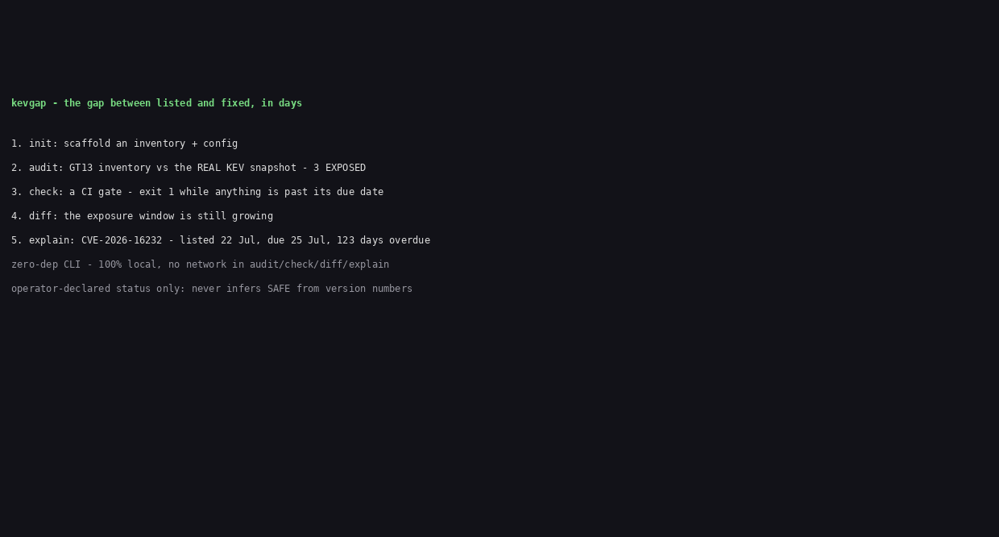

# kevgap

A zero-dependency CLI that measures the KEV exposure gap: the days between a vulnerability being listed on CISA KEV and it actually being fixed in your estate.

```sh
# Install from source (no npm package yet)
git clone https://github.com/techdevfun/kevgap.git
cd kevgap
npm install
npm run build

# Audit the GT13 example inventory against the bundled KEV snapshot
node dist/cli.js audit examples/gt13-inventory.json

# Gate CI on the KEV due date (exit 1 while anything is overdue)
node dist/cli.js check examples/gt13-inventory.json
```

## Why this exists

On 23/11/2026 GreyNoise reported the GT13 campaign: 24 Check Point
Security Management servers compromised across 22 organizations in 17
countries, with confirmed activity from 17/10 to 02/11/2026. One of the
exploited flaws, CVE-2026-16232 (Check Point SmartConsole auth bypass),
has sat on CISA KEV since 2026-07-22, with a due date of 2026-07-25.
First sighting was 02/10 - 72 days after listing. Today it is 123 days
past its KEV due date and 126 days since listing.

The gap between "listed" and "fixed" is where campaigns live. No tool
measured that gap - until now. kevgap joins an operator-maintained
inventory against the KEV catalog and reports, per asset, the exposure
window in days, with a CI gate that fails while anything is past its
due date.

## Commands

| Command | What it does |
| ------- | ------------ |
| `init [dir]` | Scaffold `kevgap.json` (inventory template) + `kevgap.config.json` |
| `audit <inventory>` | Per-asset verdicts + per-CVE exposure windows (table or `--json`), exit 0 / 1 / 2 |
| `check <inventory>` | CI gate: exit 0 when nothing is past its KEV due date, exit 1 when any asset is EXPOSED. `--fail-on-at-risk` also fails on AT-RISK |
| `diff --baseline <file> <inventory>` | Exposure windows vs a previous audit: newly overdue, newly KEV-listed, closed gaps, windows growing or shrinking. Exit 1 on regression |
| `explain <CVE-or-product>` | KEV dates, vendor, product, required action, known ransomware use. Unknown CVE answers "not in KEV" - never a false positive |
| `refresh [--url <feed-url>]` | Download the current CISA KEV feed and replace the bundled snapshot. The only command that uses the network |

All commands accept `--json` for machine-readable output. `audit`,
`check`, `diff` and `explain` are 100% local - they never touch the
network.

## Verdicts

| Verdict | Meaning |
| ------- | ------- |
| EXPOSED | Matching KEV entry, unpatched, today is past the KEV due date |
| AT-RISK | Matching KEV entry, unpatched, due date still in the future |
| SAFE | Every matching KEV entry closed: patched, with a patchedDate. The closed window is still reported, including "patched N days after due date" when it was late |
| UNKNOWN | Status unknown, matching ambiguous, or patched without a date. Listed, never a false pass or false fail |
| NOT-LISTED | No KEV entry names this product (printed, not counted as a finding) |

Status is **operator-declared**. kevgap never infers patch status from
version numbers, and KEV carries no fixed-version field, so `version`
plays no part in any verdict. An asset with no `status` is UNKNOWN.

Matching is by normalized vendor + product (case-, punctuation- and
whitespace-insensitive) or by explicit CVE id in the asset's `cves`
list, which always wins over name matching. Ambiguous names are
reported UNKNOWN with the candidates listed.

## Inventory format

```json
[
  {
    "id": "smartconsole-01",
    "vendor": "Check Point",
    "product": "SmartConsole",
    "version": "R81.20",
    "status": "unpatched"
  },
  {
    "id": "openssh-01",
    "vendor": "OpenBSD",
    "product": "OpenSSH",
    "status": "patched",
    "patchedDate": "2026-11-13"
  }
]
```

Config (`kevgap.config.json`, next to the inventory): `graceDays`
(default 0, shifts the gate date), `warnBeforeDueDays` (default 7),
`snapshotMaxAgeDays` (default 90 - an older snapshot warns on every
audit).

## Demo



Transcript: [demo/transcript.txt](demo/transcript.txt)

The demo audits the GT13 example inventory against the real bundled
KEV snapshot (catalog 2026.11.24, 1,795 entries): Check Point
SmartConsole EXPOSED 123 days past due, Citrix NetScaler EXPOSED,
Ivanti Connect Secure EXPOSED, OpenSSH patched 1 day past due.

## Honest limits

- kevgap only sees KEV-listed vulnerabilities (1,795 entries as of
  2026-11-24). Anything not on KEV is invisible to it - including the
  whole *2Shell chain (CVE-2026-123007, CVE-2026-114938,
  CVE-2026-129975, CVE-2026-132825, CVE-2026-123633). `explain` answers
  "not in KEV" for those, explicitly.
- It never scans a host, never probes a network, never detects
  vulnerabilities. It joins an operator-maintained inventory against
  the KEV catalog. Wrong status in means wrong verdict out; the
  `unknown` default and strict inventory validation are the mitigation.
- KEV carries no fixed-version field, so kevgap cannot tell from KEV
  alone whether a version is patched. Patch status is operator input.
- The bundled snapshot goes stale: entries listed after its release
  date are invisible until `refresh`. Every audit prints the snapshot
  catalog version, release date and age; age past the configured max
  warns.
- KEV due dates are the federal-agency deadlines from CISA BOD 19-02,
  not your SLA. `graceDays` exists for that reason.

## Where rivals beat us

- **vulnq** and **vuln-check** cover the full CVE universe
  (NVD/OSV/GHSA/EPSS); kevgap only sees KEV-listed vulns. They detect
  from lockfiles and SBOMs automatically; kevgap needs an
  operator-maintained inventory. They score CVSS/EPSS; kevgap does not
  score severity at all - KEV listing is the only signal.
- **Trivy / Grype** scan real installed software; kevgap trusts what
  the operator wrote.
- **VulnCheck community KEV API** offers an extended KEV dataset, but
  needs an API key and a network call per lookup; kevgap is offline.

What kevgap does that they do not: measure the exposure window per
asset in days, gate CI on the KEV due date, and diff the gap over time
from a local inventory with no network and no keys.

## Snapshot provenance

`data/kev-snapshot.json` is the full CISA KEV catalog as downloaded
2026-11-25, trimmed to the 8 fields kevgap reads (`cveID`,
`vendorProject`, `product`, `vulnerabilityName`, `dateAdded`,
`dueDate`, `knownRansomwareCampaignUse`, `shortDescription`):

- catalogVersion: 2026.11.24
- dateReleased: 2026-11-24T17:47:46Z
- fetched: 2026-11-25
- source: https://www.cisa.gov/sites/default/files/feeds/known_exploited_vulnerabilities.json
- entries: 1,795

Re-trim it any time with `python3 scripts/trim-snapshot.py <feed.json>`,
which re-verifies the catalog version, the entry count and the four
pinned CVE rows before writing.

## Development

```sh
npm install
npm run build    # tsc strict
npm test         # unit + e2e (live smoke is separate)
npm run test:live
npm run lint     # eslint + prettier
node scripts/preflight.js
```

## Roadmap

- SARIF output for code scanning integrations (P2)
- GitHub Action wrapper (P2)
- Trend of the worst window across baselines (P2)
- Weekly digest via the operator's own cron (P1, after 0.1.0)
- Per-team inventories + merged report (P2)
- Optional NVD overlay for non-KEV CVEs (P3, not promised for 0.1.0)

Not doing: built-in email/Telegram/Teams sending (the operator's cron
and existing alerting own delivery), SSO/audit log/server (local CLI,
no server), any patching (read-only audit by design).

## License

MIT
